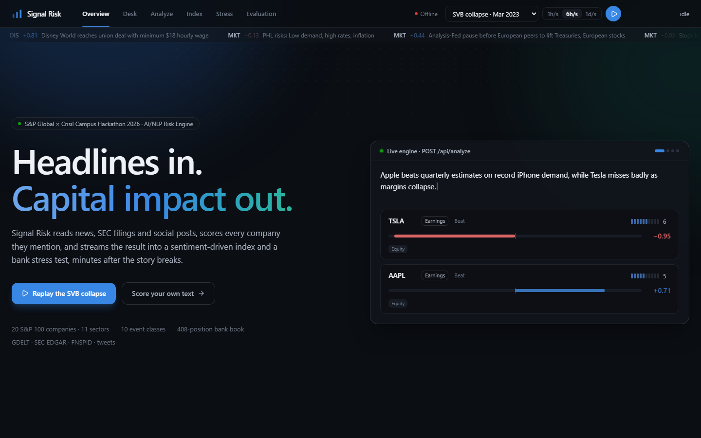
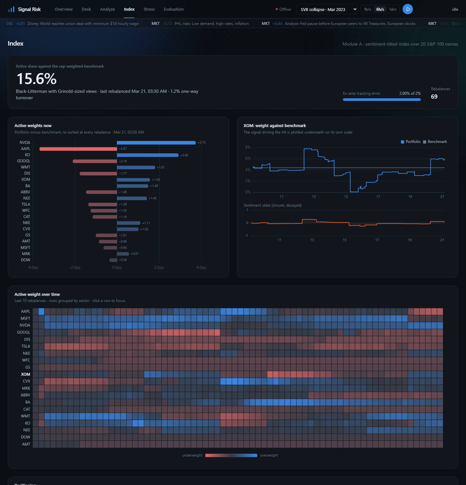

# Signal Risk: AI/NLP Financial Risk Engine

**S&P Global & Crisil Campus Hackathon 2026**

| | |
|---|---|
| **Candidate Name** | Naman Karwa |
| **College Email ID** | n.karwa@iitg.ac.in|
| **College / Campus** | Indian Institute of Technology Guwahati |
| **Demo Video Link** | [YouTube, unlisted: link to be added] |
| **Slide Deck** | [docs/presentation.pdf](docs/presentation.pdf) |



---

## 1. Project Overview

### Problem

Markets react to text (news, regulatory filings, social media) long before that information shows up in prices,
ratings or financial statements. Risk teams need that text as **structured, machine-readable signals** they can feed
into portfolio and capital decisions.

### Approach

**The engine** ingests four text sources and, for every *(item, company)* pair, produces:

| Output | What it is |
|---|---|
| **Sentiment** | Score in [−1, 1], **per entity**: "Apple beats, while Tesla misses" gives AAPL +0.71 and TSLA −0.95 |
| **Event class** | Multi-label over 10 classes (geopolitical, macroeconomic, credit event with ISDA-style subtypes, M&A, earnings, product, regulatory/legal, management, operational, none) |
| **Impact** | Score from 1 to 10, tested against realised abnormal stock returns (a weak but positive ranking) |
| **Scope and channels** | Countries, sectors, commodities, currencies, plus the market channels affected (rates, spreads, equity, FX, commodities) |

Before any scoring, the ingestion layer handles what decides signal quality:
- **entity linking** with ambiguity handling ("apple pie" is not AAPL; "the Dow" is not Dow Inc);
- a **financial-relevance gate** for general news;
- **story clustering**, so syndicated copies count once and breadth of coverage becomes a feature;
- **novelty** and **source credibility**.

Two downstream applications subscribe to the live signal stream:

- **Module A: Sentiment-driven index rebalancer.** Turns per-company sentiment into Black-Litterman views, sizes them
  with Grinold's rule (α = IC × σ × z) and optimises a 20-stock index under a hard 2% ex-ante tracking-error budget,
  with weight caps and a no-trade band.
- **Module B: Event-triggered stress test.** A corroborated high-impact negative event triggers a scenario calibrated
  to a historical analogue (2008, 2020, 2022), scaled by the engine's impact score and targeted by its scope. The
  scenario is applied to a synthetic 408-position **wholesale banking book**:
  - loans are valued through **IFRS 9 expected credit loss**, with stressed PDs from the **Vasicek / Basel IRB** model;
  - bonds, swaps, FX and CDS are marked to market;
  - **CET1** is recomputed against the regulatory minimum and buffers.

  The page then shows factor attribution and the severity at which capital breaks (reverse stress test).

---

## 2. Architecture & Tech Stack


```
sources ──► ingestion ────────────────► NLP engine ─────────────────► signal store ──► REST + SSE ──► Module A (index)
GDELT GKG   timestamps, entity linking,  entity sentiment (FinBERT)     DuckDB                        Module B (stress)
EDGAR 8-K   relevance gate, MinHash      events (student + zero-shot)                                 React dashboard
FNSPID      story clusters, novelty,     impact (rule, event-study
tweets      source credibility           tested by event study)
```

| Layer | Choices |
|---|---|
| NLP | PyTorch (CUDA optional), Hugging Face Transformers: ProsusAI/FinBERT, DeBERTa-v3 zero-shot NLI, fine-tuned FinBERT event student; datasketch MinHash LSH |
| Quant | pandas, NumPy, SciPy, scikit-learn (Ledoit-Wolf), cvxpy, LightGBM |
| Data & serving | DuckDB, Parquet, FastAPI (REST + server-sent events) |
| Frontend | React 19, TypeScript, Vite, Tailwind CSS, Apache ECharts, TanStack Query, Motion |
| LLM teacher (optional) | Any OpenAI-compatible endpoint; Groq free tier (`openai/gpt-oss-120b`) by default. No paid APIs. |

### API

| Endpoint | Purpose |
|---|---|
| `POST /api/analyze` | Score any text: per-entity sentiment, event, impact, scope |
| `GET /api/signals` | Stored signals, filterable by entity, event and minimum impact |
| `GET /api/stream` | Server-sent events: `signal`, `index`, `stress`, `status` |
| `GET /api/index/current`, `/history` | Module A weights, views, tracking error |
| `POST /api/stress/run` | Run a systemic or single-name scenario |
| `GET /api/stress/curve`, `/compare`, `/library` | Reverse stress curve, scenario comparison, calibrated library |
| `POST /api/replay/start`, `/stop` | Replay a historical stream, or `name: "live"` to poll GDELT and EDGAR now |

Interactive docs: http://localhost:8000/docs once the backend runs.

### Repository layout

```
config/       universe, event taxonomy, stress scenarios (calibrated)
data/         replay streams, synthetic bank book, gold set, evaluation outputs (see data/README.md)
docs/         architecture, presentation, methodology notes, screenshots
frontend/     React dashboard
scripts/      data building, backtest, calibration, teacher and student training
src/riskengine/
  ingest/     GDELT, SEC EDGAR, FNSPID, tweets
  nlp/        entities, clustering, sentiment, events, impact, pipeline
  modules/    index/ (Module A), stress/ (Module B)
  market/     prices, FRED, event study
  api/        FastAPI app
tests/        69 pytest tests
```

---

## 3. Dataset Used

All data is **public or synthetic**. No S&P Global or Crisil proprietary data is used. Full sources, licences and
rebuild steps: [data/README.md](data/README.md).

| Source | Use |
|---|---|
| **GDELT 2.0 GKG** (15-minute global news files) | Live news (polled every 5 minutes in live mode) and crisis replays |
| **SEC EDGAR 8-K filings** | Item codes act as authoritative event labels (e.g. 2.04 debt acceleration) |
| **FNSPID** (`Zihan1004/FNSPID`) | Ticker-tagged financial news, 2009–2023; backtest and gold set |
| **Stock tweets** (`mjw/stock_market_tweets`) | Social-media source |
| **twitter-financial-news-topic** | Public labelled data for the event student |
| **yfinance, FRED** | Prices for the event study and backtest; rates, credit spreads, VIX, oil for scenario calibration |
| **Synthetic bank book** (`data/synthetic/`) | 408 positions, 80 counterparties; the 20 universe companies appear as counterparties so company signals hit real exposures |

**Universe:** 20 S&P 100 names covering all 11 GICS sectors (AAPL, MSFT, NVDA, GOOGL, DIS, TSLA, NKE, GS, WFC, XOM, CVX,
MRK, ABBV, BA, CAT, KO, WMT, NEE, DOW, AMT), chosen for dense 2022–2023 news coverage
([docs/data_audit.md](docs/data_audit.md)).

**Assumptions:**
- Historical text is mostly date-stamped, so backtests trade on the next day.
- Benchmark weights use current shares outstanding.
- Rating PDs are rounded long-run averages from public literature.

---

## 4. Quickstart & Installation

**Requirements:** Python 3.11–3.13 and Node.js 20.19+. Tested on Windows 11 with Python 3.13 and Node 20. A GPU is
optional; on CPU the engine is slower, so pick the 1h/s replay speed.

### 1. Backend

```bash
git clone https://github.com/namank04/AI-NLP-Risk-Engine.git
cd AI-NLP-Risk-Engine

python -m venv .venv
.venv\Scripts\activate                     # macOS/Linux: source .venv/bin/activate
pip install torch --index-url https://download.pytorch.org/whl/cpu    # NVIDIA GPU: .../whl/cu128
pip install -r requirements.txt
pip install -e .

uvicorn riskengine.api.app:app --port 8000
```

### 2. Frontend (second terminal)

```bash
cd frontend
npm install
npm run dev                                # open http://localhost:5173
```

On first use, the backend downloads the NLP models from Hugging Face (about 1.5 GB) and daily prices from Yahoo
Finance. The replay streams, bank book, backtest and evaluation outputs are already in the repository.

### 3. Demo walkthrough

1. **Overview**: the engine card scores sample headlines live through `/api/analyze`. Press **Replay the SVB collapse**.
2. **Desk**: stories stream in grouped by cluster, with per-company tone, event mix and high-impact alerts.
3. **Index**: active weights re-sort with every rebalance, within the tracking-error budget.
4. **Stress**: when the engine fires a scenario, an alert appears and the CET1 gauge drains to the stressed ratio.
   Drag the severity slider to see projected CET1 from the model's reverse-stress curve.
5. **Analyze**: paste any text. Each entity's clause is highlighted with its sentiment.
6. **Live**: pick **Live now · GDELT + SEC** in the header and press play. The backend fetches the last hour of GDELT
   news and recent 8-K filings, then polls every 5 minutes; everything downstream works exactly as in a replay.

| Stress (Module B) | Index (Module A) |
|---|---|
|  |  |

### Optional

```bash
python -m pytest                           # 69 tests
python scripts/train_students.py           # event student (~5 min on a GPU); used automatically once trained
cp .env.example .env                       # add a free Groq key, then:
python scripts/run_teacher.py gold         # LLM teacher labels; resumes daily within the free quota
```

---

## 5. Key Results & Domain Impact

Every number below comes from scripts in this repository; methodology is in `docs/`.

| Area | Result |
|---|---|
| **Impact score** ([impact_model.md](docs/impact_model.md)) | On 2,141 held-out stock-days (H2 2023), impact ranks realised 2-day abnormal moves with Spearman ρ = 0.059 (≈2.7 s.e.). Practically this is weak: stories in the top half are followed by moves about 25% larger (median 1.17% vs 0.94%), and the deciles are not monotone. A LightGBM alternative (0.072) was not significantly better, so the transparent rule stays. Impact is used as one gate of the stress trigger, together with corroboration and negative sentiment, not as a stand-alone predictor. |
| **Event classification** | Fine-tuned FinBERT student: macro-F1 **0.94** vs **0.48** for zero-shot NLI on 2,454 held-out finance tweets, after dropping 651 validation tweets that duplicate training text. **This does not transfer fully to news:** on 120 news items labelled by the LLM teacher, the production classifier scores 0.54 vs 0.49. |
| **Sentiment timing** ([backtest.md](docs/backtest.md)) | Sentiment agrees with the same-day abnormal move (ρ = +0.086) but, traded a day later, mildly reverses (IC −0.024, t −2.0): news is priced within a day. This is why the live index rebalances on 15-minute news rather than daily. |
| **Module A**, 2022–2023 walk-forward | The optimiser enforces a 2% ex-ante tracking-error constraint (median ex-ante TE across 509 rebalances 2.00%, max 2.2% when the no-trade band holds old weights); realised TE 2.1% (daily active returns × √252). +1.1% p.a. active return, IR 0.52 (t 0.74, not significant), 5 bp costs. |
| **Module B calibration** | At full historical severity, CET1 (13.5% base) falls 3.4 pp (geopolitical), 4.7 pp (2022 rates), 6.4 pp (2008 credit) and 6.0 pp (2020 pandemic): instantaneous shocks, in line with regulatory severely adverse scenarios. |
| **Reverse stress** | The book falls below its 8% CET1 requirement at **84%** of Lehman-2008 severity, 90% of March-2020 and 120% of the 2022 rates shock; the geopolitical scenario never breaches up to 150%. |
| **SVB replay** (Mar 2023) | The systemic credit scenario triggers on the SVB liquidity crisis (10 Mar), then re-runs on Credit Suisse contagion (15 Mar) and the First Republic downgrade (20 Mar). Zero false alarms on a quiet 48-hour stream. |

**Why it matters:** a risk team sees a credible event within minutes, along with its capital impact on the bank and
the exposures driving it, instead of waiting for the next scheduled stress-testing cycle. The same signals rebalance a
portfolio under explicit risk limits.

---

## 6. Limitations & Next Steps

This is a working prototype. The results above are preliminary and should be read with these limits in mind.

**Signals (NLP)**
- **Impact is a heuristic, not a calibrated probability.** It is a transparent formula (event base severity × sentiment
  strength × novelty × outlet count × source credibility), rounded to 1–10. Against realised abnormal returns it ranks
  only weakly (ρ = 0.059). On the Ukraine replay the invasion day scored 6, one short of the trigger.
- **Impact → scenario severity is a policy choice.** Severity = (impact − 4) / 6, clipped to 20–100%. It is a tunable
  setting for the risk team, not an estimated relationship between a news score and real losses.
- **Event accuracy on news is preliminary.** 0.94 macro-F1 is on finance tweets (six classes, our topic mapping). On
  news the only check so far is 120 items labelled by an LLM teacher, not humans (0.54 vs 0.49 zero-shot). Credit,
  operational and product events rely on zero-shot NLI plus keyword rules, and those rules can override the model.
- **Entity attribution can leak.** When a sentence naming two companies cannot be split into clauses, both receive
  the whole sentence's sentiment.
- **Lexicon-based context.** Source credibility is a fixed table, and country, sector and commodity scope is detected
  from mentions, not causality or exposure. Outlets are counted by publisher name, so syndicated copies of one wire
  story count as separate outlets.

**Modules**
- **The bank is a scenario simulator, not a validated capital model.** The book is synthetic, CET1 is set to start at
  13.5%, and credit-factor shocks, revolver drawdowns and parts of market and operational risk capital are simplified or
  expert-set. Scenario market moves are calibrated to history.
- **The tracking-error limit is ex-ante.** The optimiser enforces 2% against an estimated covariance; held weights can
  exceed it slightly while the no-trade band applies (up to 2.2%), and realised TE was 2.1%.
- **Index fallback.** Without market data the index uses equal weights and a simple tilt with no risk model; the
  Index page then shows a degraded-mode warning.
- **Historical timing.** Date-only timestamps force next-day trading in backtests, where news is already priced, so the
  backtest cannot measure performance at the 15-minute speed of live mode.

**System**
- **Live mode is a laptop prototype.** It polls GDELT and EDGAR every 5 minutes; signals arrive roughly 15–30 minutes
  after publication. Its record of processed items is in memory, so a restart can replay the last hour into the
  modules.
- **Local use only.** The API has open CORS and no authentication on stress-run and labelling routes; both need
  restricting before any public deployment.

**Next steps:**
- a human-labelled news test set covering every event class;
- silver labels for the missing classes, then retrain;
- calibrating impact against losses;
- restart-safe ingestion;
- authentication and hosting;
- intraday prices for a latency-aware backtest.

---

Licensed under the [MIT License](LICENSE).
