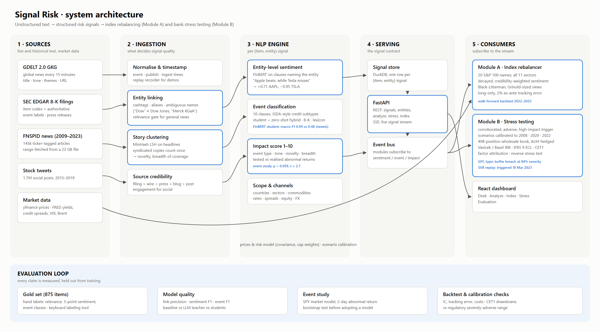
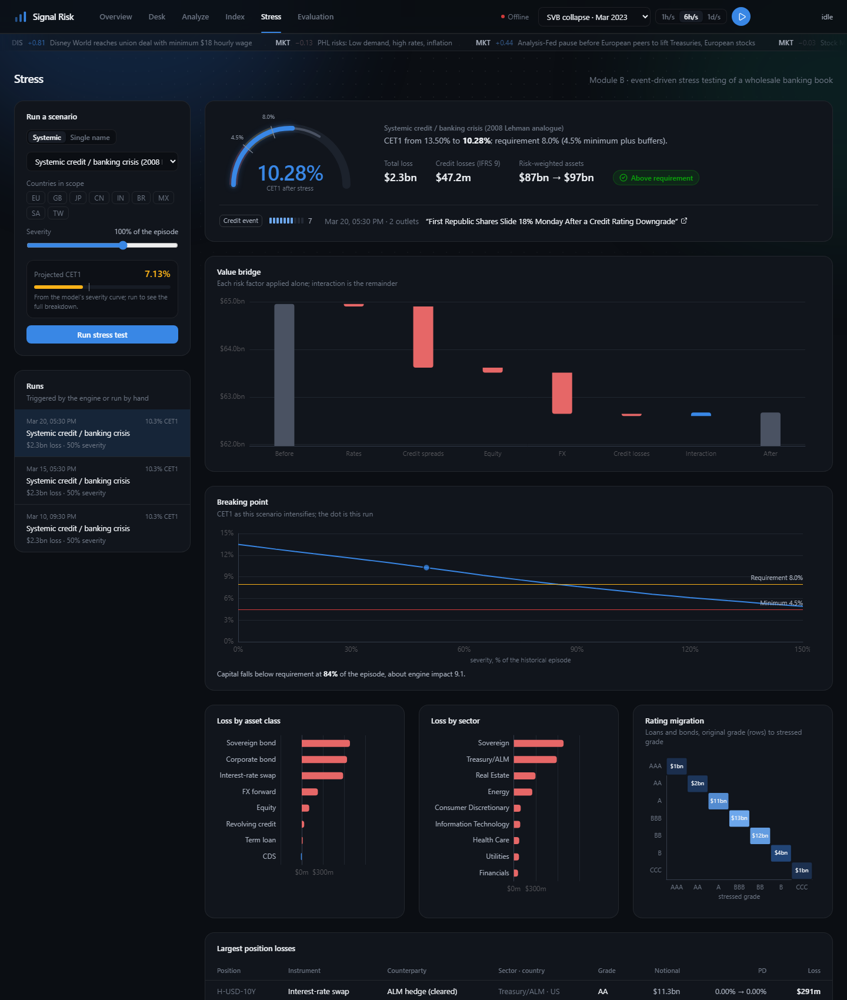

# Signal Risk: AI/NLP Financial Risk Engine - S&P Global & Crisil Campus Hackathon

**Candidate Name:** Naman Karwa
**College Email ID:** namankarwa311@gmail.com
**College / Campus:** Indian Institute of Technology Guwahati
**Demo Video Link:** [YouTube, unlisted: link to be added]
**Slide Deck Link (if hosted externally):** [docs/presentation.pdf](docs/presentation.pdf)

## 1. Project Overview / Problem Statement & Approach

Markets react to unstructured text (news, filings, social media) long before that information shows up in
structured data. This project turns that text into **machine-readable risk signals** and feeds them into
two downstream risk applications.

**The engine** ingests news (GDELT, FNSPID), SEC 8-K filings (EDGAR) and social posts (stock tweets), then for
every *(item, entity)* pair produces:

- **Sentiment** in [-1, 1], scored **per entity**: "Apple beats, while Tesla misses" yields +0.71 for AAPL and -0.93 for TSLA.
- **Event classification**: multi-label over a 10-class taxonomy (Geopolitical, Macroeconomic, Credit Event with
  ISDA-style subtypes, M&A, Earnings, Product Launch, Regulatory/Legal, Management Change, Operational, None).
- **Impact score** (1-10) plus the **transmission channels** (rates, credit spreads, equity, FX, commodities) and
  **scope** (countries, sectors, commodities, currencies) that downstream stress tests need.

Before any scoring, the ingestion layer does the work that decides signal quality: **entity linking** with
ambiguity handling ("Apple pie" is not AAPL), a **financial-relevance gate** for general news, **story clustering**
(syndicated copies count once; breadth of coverage becomes a feature), **novelty** and **source credibility**.

**Module A (index rebalancer)** subscribes to entity sentiment and tilts a 20-stock, 11-sector S&P 100 index away
from cap weights, w ∝ b·exp(κx), with an evidence-shrunk, time-decayed signal, weight caps and a no-trade band.

**Module B (stress testing)** subscribes to event class and impact. A corroborated high-impact event triggers a
scenario calibrated to a historical analogue (2008, 2020, 2022), scaled by impact and targeted by the engine's
scope, and applied to a synthetic **wholesale banking book**:
- loans valued through **IFRS 9 ECL** (stage 2 lifetime losses), with stressed PDs from the **Vasicek/Basel IRB** model
- revolver drawdowns
- bonds, swaps, FX and CDS marked to market
- **CET1** recomputed against regulatory buffers with Basel IRB credit RWA

## 2. Architecture & Tech Stack



```
sources ─► ingestion ─────────────────► NLP engine ───────────────► signal store ─► REST + SSE API ─► Module A
GDELT GKG   normalise, timestamps,       entity sentiment (FinBERT),   DuckDB                            Module B
EDGAR 8-K   entity linking + relevance,  events (lexicon + NLI;        (flattened                        React dashboard
FNSPID      story clustering, novelty,    student models, Stage 4),    signals)
tweets      credibility, replay log      impact (rule -> event study)
```

| Layer | Choices |
|---|---|
| NLP | PyTorch (CUDA), Hugging Face Transformers: ProsusAI/FinBERT, DeBERTa-v3 zero-shot NLI; datasketch MinHash; local/free LLM teacher (OpenAI-compatible) |
| Quant | pandas, NumPy/SciPy, statsmodels, PyPortfolioOpt/cvxpy, LightGBM |
| Data & serving | DuckDB, Parquet, FastAPI (REST + server-sent events) |
| Frontend | React 19 + TypeScript, Vite, Tailwind CSS, Apache ECharts, TanStack Query |

## 3. Dataset Used

All data is public or synthetic; see [data/README.md](data/README.md) for sources, licences and exact files.

- **GDELT 2.0 GKG** (15-minute global news files): titles, URLs, tone, themes.
- **SEC EDGAR 8-K filings**: item codes serve as authoritative event labels.
- **FNSPID** (Hugging Face `Zihan1004/FNSPID`): ticker-tagged financial news, 2009-2023.
- **Stock tweets** (`mjw/stock_market_tweets`): 1.7M tweets for 5 large caps, 2015-2019.
- **Market data**: yfinance daily prices; FRED rates, credit spreads, VIX and oil.
- **Universe**: 20 S&P 100 names across all 11 GICS sectors (AAPL, MSFT, NVDA, GOOGL, DIS, TSLA, NKE, GS, WFC,
  XOM, CVX, MRK, ABBV, BA, CAT, KO, WMT, NEE, DOW, AMT), chosen per sector for dense 2022-2023 news coverage;
  FNSPID has no articles for JPM, BAC, JNJ, UNH, PG or META (see [docs/data_audit.md](docs/data_audit.md)).
- **Synthetic wholesale banking book** (`data/synthetic/portfolio.csv`): 408 positions, 80 counterparties.
  Exposures and internal ratings are synthetic; the 20 universe companies appear as counterparties so that
  company-level signals hit real exposures.

Key assumptions:
- Historical text is mostly date-stamped, not time-stamped, so backtests trade on the next day.
- Benchmark weights use current shares outstanding.
- Rating PDs are rounded long-run averages from public literature.

## 4. Quickstart & Installation

Runtime: **Python 3.11-3.13** and **Node.js 20.19+** (tested: Python 3.13, Node 20, Windows 11).
A GPU is optional; on CPU the engine is slower, so use the 1h/s or 6h/s replay speed.

```bash
git clone https://github.com/namank04/AI-NLP-Risk-Engine.git
cd AI-NLP-Risk-Engine

python -m venv .venv
.venv\Scripts\activate                    # macOS/Linux: source .venv/bin/activate
pip install torch --index-url https://download.pytorch.org/whl/cpu      # NVIDIA GPU: .../whl/cu128
pip install -r requirements.txt
pip install -e .

uvicorn riskengine.api.app:app --port 8000
```

In a second terminal:

```bash
cd frontend
npm install
npm run dev                               # open http://localhost:5173
```

Pick a replay in the header (e.g. **SVB collapse · Mar 2023**) and press play: signals stream into the Desk, the
index rebalances (Index) and qualifying events trigger stress tests (Stress); any scenario can also be run by hand.

First start downloads the NLP models from Hugging Face (~1.5 GB) and daily prices from Yahoo Finance; the replay
streams, synthetic bank book, backtest and evaluation results are in the repository, so nothing else is needed.

Optional:

```bash
python -m pytest                          # 65 tests
python scripts/train_students.py          # event student (~5 min on a GPU); the engine uses it once trained
cp .env.example .env                      # add a free Groq key, then:
python scripts/run_teacher.py gold        # LLM teacher labels; resumes daily within the free quota
```

Rebuilding the data from source is documented in [data/README.md](data/README.md).

### Dashboard

| Page | What it shows |
|---|---|
| **Desk** | Live stream grouped by story, market tone, tone by company, high-impact alerts |
| **Analyze** | Paste any text and get the structured signal per entity |
| **Index** (Module A) | Black-Litterman index: active weights over time, positioning, per-name drill-down, 2022-2023 evidence |
| **Stress** (Module B) | CET1 after each triggered scenario, value bridge, breaking-point (reverse stress) curve, scenario library calibrated to 2008/2020/2022, the book |
| **Evaluation** | Impact-score validation by event study, model quality on the gold set, labeling tool |



## 5. Key Results & Domain Impact

*Work in progress; validated numbers so far (details in `docs/`).*

- **Impact score validated by event study** ([docs/impact_model.md](docs/impact_model.md)): on 2,141 held-out
  stock-days (H2 2023), the impact score ranks realised 2-day abnormal moves with Spearman ρ = 0.059
  (≈2.7 standard errors). A LightGBM model reached 0.072, but the paired-bootstrap gain (+0.013, 95% CI −0.029..+0.057)
  was not significant, so production keeps the transparent rule.
- **News is priced within about a day** ([docs/backtest.md](docs/backtest.md)): sentiment agrees with the same-day
  abnormal move (ρ = +0.086), but traded a day later (date-stamped history) the signal shows mild reversal
  (IC −0.024, t −2.0). This is why Module A rebalances intraday on 15-minute GDELT timestamps.
- **Module A, Black-Litterman with Grinold-sized views and a 2% ex-ante TE budget:** realised TE 2.1% (on target),
  +1.1% p.a. active return, IR 0.52 (t 0.74, not significant) over 2022-2023 with 5 bp costs.
- **Reverse stress test:** the book breaches its 8% CET1 requirement at 84% of Lehman-2008 severity and 90% of
  March-2020 severity; a 2022-style rates shock needs 120%; the Russia-Ukraine shock never breaches up to 150%.
- **Module B on the SVB crisis replay (Mar 2023):** systemic credit scenario triggered on "Silicon Valley Bank's
  Liquidity Crisis…" (10 Mar), re-run on the Credit Suisse contagion and First Republic downgrade; zero false
  alarms on two quiet days of live news.

- **Engine:** ~37 items/s on a laptop RTX 3050 (1 GB VRAM peak); entity-targeted sentiment; event student beats
  zero-shot 0.95 vs 0.48 macro-F1 on held-out finance tweets; gold set of 875 items for evaluation on news.
- **Module B calibration:** at full historical severity the CET1 ratio falls by 3.5pp (geopolitical), 5.1pp (rates
  shock), 6.0pp (GFC-type credit event) and 5.7pp (pandemic). These are instantaneous shocks, consistent in order of
  magnitude with regulatory severely adverse scenarios. Factor attribution explains each loss.
- **Why it matters:** risk teams see a credible event within minutes, with the bank-level capital impact and the
  exposures driving it, instead of after the next scheduled stress-testing cycle.

## 6. Limitations & Next Steps

- **Impact score is the weakest link.** It is validated (ρ = 0.059 vs realised abnormal moves) but modest; on the
  Ukraine replay the invasion day itself scored 6, just under the stress trigger of 7, so the first systemic run
  came on 27 Feb (Kharkiv, SWIFT cut-off). Better event features from the LLM-teacher → student models are the
  planned fix; the gold set (875 items, `docs/labeling_guidelines.md`) is built to measure that.
- **Event classification** uses a fine-tuned FinBERT student (trained on 12.8k public finance tweets; macro-F1 0.95
  vs 0.48 for zero-shot on held-out tweets) for the six classes it has data for, and zero-shot NLI for credit,
  operational and product events. That validation is in-domain; the gold set measures transfer to news. The Groq
  teacher (`python scripts/run_teacher.py silver`) adds silver labels for the missing classes across the free tier's
  daily quota, then `python scripts/train_students.py` retrains.
- **Historical timing.** Date-only timestamps force next-day trading in backtests, where news has already been
  priced; the live system works on 15-minute GDELT timestamps.
- **Synthetic book.** Exposures, ratings and LGDs are generated; scenario market moves are calibrated to history,
  while credit-factor shocks and revolver drawdowns are expert-set.
